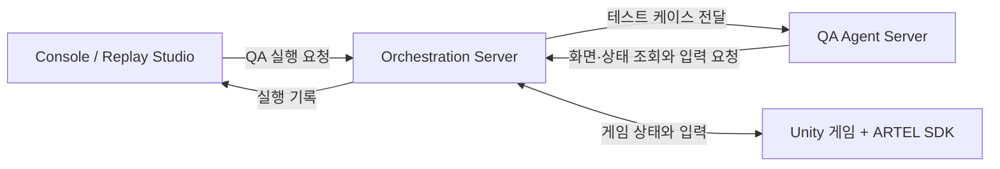

# ARTEL

ARTEL은 QA agent가 Unity 게임을 직접 플레이해 테스트하는 도구입니다. 테스트 케이스를 실행하면 agent가 게임 화면과 상태를 보고 입력을 보냅니다. 실행 결과와 각 단계의 화면은 Replay Studio에서 확인할 수 있습니다.

[ARTEL](https://artel.kr) · [Unity SDK 설치](https://github.com/project-artel/artel-sdk#install) · [Docker 설치](https://github.com/project-artel/artel/tree/main/deploy)

## Unity SDK와 QA 벤치마크

- **게임 코드 수정 없이 SDK 연결.** Unity Package Manager에서 패키지를 설치하면 에디터와 개발 빌드에 SDK가 붙습니다. [Unity SDK](https://github.com/project-artel/artel-sdk#install)
- **WordVenture 테스트 35개, 시나리오 4개.** 세이브·리셋부터 엔딩까지 다룹니다. 게임에서 충족할 수 없는 기대 조건도 넣어, agent가 실패를 통과로 보고하는지 확인합니다. [벤치마크와 정답표](https://github.com/project-artel/artel/tree/main/benchmarks)

## QA 실행 흐름

## 저장소

| 저장소 | 역할 |
| --- | --- |
| [artel-home](https://github.com/project-artel/artel-home) | 테스트 실행과 결과 확인, Replay Studio |
| [artel-orchestration-server](https://github.com/project-artel/artel-orchestration-server) | 프로젝트와 QA 실행을 관리하고 SDK와 agent를 연결 |
| [artel-agent-server](https://github.com/project-artel/artel-agent-server) | 게임 상태를 보고 다음 행동과 테스트 결과를 판단 |
| [artel-sdk](https://github.com/project-artel/artel-sdk) | Unity 게임의 상태를 읽고 클릭과 키 입력을 전달 |
| [artel-cli](https://github.com/project-artel/artel-cli) | 터미널에서 QA 실행 |
